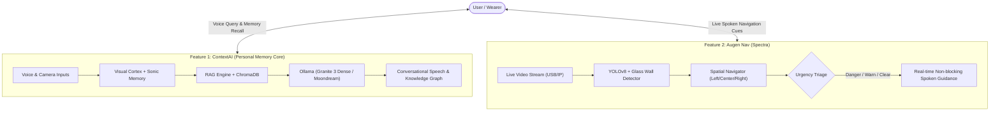
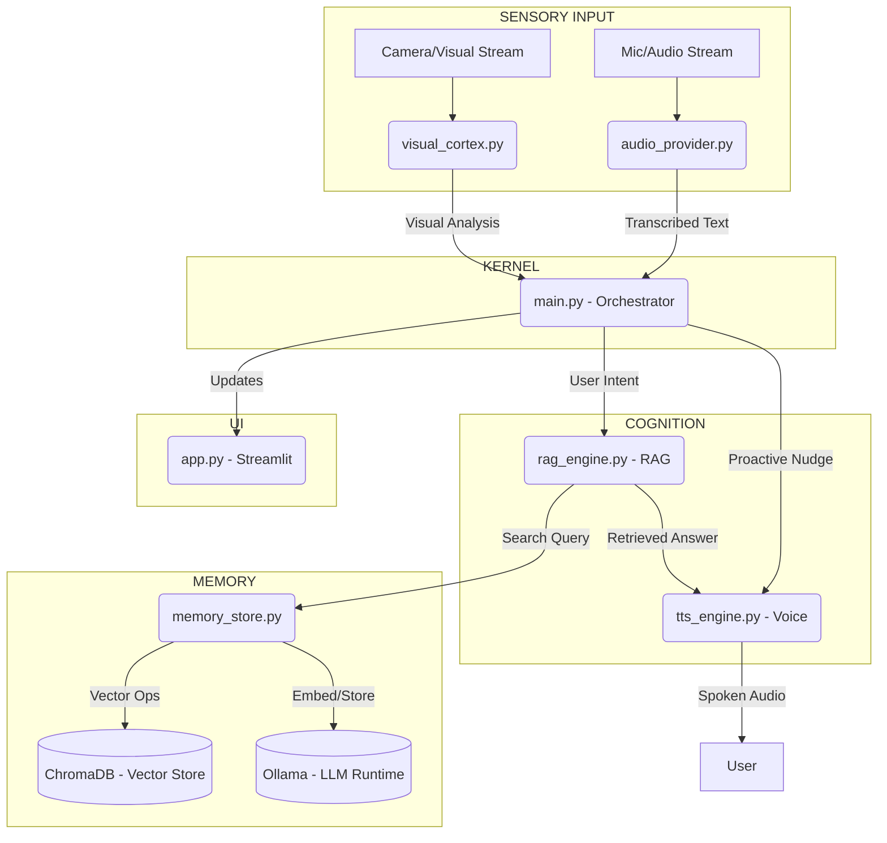

# Augen

> **Augen** (German for *"Eyes"*) — A Unified Multimodal AI Platform combining Continuous Contextual Memory with Real-Time Assistive Spatial Navigation for Wearables and Edge Devices.

**Domain:** Assistive Technology, Multimodal AI, Edge Computing  
**Platform:** Local-First, Privacy-Preserving, GPU-Accelerated

---

## Architecture Overview: Two Core Features

Augen brings together two complementary intelligent pillars into a single local-first architecture:



| Feature | Directory | Focus & Capabilities |
|---|---|---|
| **Feature 1: ContextAI (PMC)** | `./` (Root) | **Second Brain & RAG:** Hands-free voice memory capture (VAD + Whisper), visual text/scene fusion (Moondream + EasyOCR), ChromaDB vector storage, grounded conversational retrieval, and Pyvis knowledge graphs. |
| **Feature 2: Augen Nav (Spectra)** | [`blind-nav/`](blind-nav/) | **Real-Time Spatial Navigation:** Assistive obstacle avoidance for visually impaired users. YOLOv8 object detection, Canny edge glass wall detection, left/center/right spatial awareness, urgency triage (`Stop!`, `Caution`, `Path Clear`), and low-latency TTS. |

---

## 1. Feature 1: Personal Memory Core (PMC / ContextAI)

The Personal Memory Core (PMC) is a Python-based prototype for a privacy-preserving AI assistant designed for next-generation wearable computing, such as smart glasses. It functions as a "Second Brain," capturing multimodal sensory data (audio, visual) and structuring it into a queryable, semantic memory. This allows the user to recall details from their life with enhanced fidelity.

This project directly engages with several core challenges in applied AI research:
*   **Retrieval-Augmented Generation (RAG):** The system implements a sophisticated RAG pipeline to mitigate LLM hallucination. It grounds the AI's responses in a factual, personal memory database rather than relying solely on its internal training data.
*   **Multimodal Fusion:** PMC demonstrates a practical approach to multimodal AI by fusing data from independent vision and audio pipelines. It combines semantic scene descriptions from a Vision-Language Model (Moondream) with symbolic data from Optical Character Recognition (EasyOCR) to create rich, contextual memories.
*   **Edge AI and Privacy:** The entire software stack runs 100% locally on consumer-grade hardware, leveraging the Ollama ecosystem. This architecture ensures user privacy, eliminates cloud subscription costs, and provides low-latency responses essential for a real-time wearable device.

### 1.1 Use Cases
*   **Wearable AI prototypes:** Backend for smart glasses and AR assistants.
*   **Local-first AI research:** Privacy-preserving, local-only LLM applications.
*   **Applied RAG systems:** Implementation for personal knowledge management and contextual assistance.

---

## 2. Key Features

*   **Hands-Free Sonic Memory:** Utilizes Voice Activity Detection (VAD) and local Whisper transcription to automatically capture and log spoken thoughts or conversations.
*   **Visual Intelligence (Vision Fusion):** The system generates descriptions of objects and scenes via Moondream while simultaneously extracting text via EasyOCR.
*   **Intelligent Storage:** Memories are enriched with metadata (Entities, Topic, Priority) and stored as vectors in ChromaDB.
*   **Conversational RAG:** Natural language querying with context-aware responses grounded in personal history.
*   **Anti-Hallucination Guardrails:** Calibrated relevance thresholds (distance < 400.0) ensure responses are based on factual data.
*   **Natural Voice Output:** Employs the Kokoro-ONNX neural TTS engine for a hands-up conversational experience.
*   **Proactive Intelligence:** Background monitoring for patterns in recent memories to offer insights.
*   **Interactive Knowledge Graph:** A Pyvis-based visualization tool for mapping connections between memories and entities.

---

## 3. The RAG Pipeline

The PMC Retrieval-Augmented Generation pipeline ensures grounded responses:

1.  **Query Embedding:** Natural language queries are converted into high-dimensional vectors via nomic-embed-text.
2.  **Vector Search:** Semantic search against ChromaDB vectors using cosine similarity or L2 distance.
3.  **Relevance Filtering:** A calibrated threshold (< 400.0) filters irrelevant results to maintain factual integrity.
4.  **Context Injection:** Relevant memories and chat history are injected into the system prompt.
5.  **LLM Generation:** The granite3-dense:2b model generates answers grounded in the provided context.

---

## 4. Architecture and Tech Stack

PMC uses a modular, biomimetic architecture where each component manages a specific cognitive function.

### Architecture Diagram


### Tech Stack
*   **Language:** Python 3.10+
*   **LLM Runtime:** Ollama (granite3-dense:2b, moondream:1.8b, nomic-embed-text:v1.5)
*   **Vector Database:** ChromaDB
*   **Speech-to-Text:** Whisper (via whisper-cpp-python)
*   **Text-to-Speech:** Kokoro-ONNX
*   **OCR:** EasyOCR
*   **Interface:** Streamlit
*   **Visualization:** Pyvis

---

## 5. Setup and Usage

### Prerequisites
1.  **Hardware:** NVIDIA GPU (min. 6GB VRAM recommended).
2.  **Python:** 3.10 or newer.
3.  **Ollama:** Service must be installed and running.

### Installation
1.  Clone the repository and install dependencies:
    ```bash
    pip install -r requirements.txt
    ```
2.  Download required models:
    ```bash
    ollama pull granite3-dense:2b
    ollama pull nomic-embed-text
    ollama pull moondream:1.8b
    ```
3.  Install Whisper with CUDA support:
    ```bash
    $env:CMAKE_ARGS="-DWHISPER_CUBLAS=ON"; pip install whisper-cpp-python
    ```

---

## 6. Example Usage Flow
1.  **Save a memory:** Say *"Remember that the budget for Project Alpha is 1.5 million dollars."*
2.  **Ask a question:** Say *"What is the budget for Project Alpha?"*
3.  **Get a spoken answer:** The system will reply *"The budget for Project Alpha is 1.5 million dollars."*
4.  **Ask a follow-up:** Say *"Who is the project manager?"* (Assuming you've previously mentioned Alice is).
5.  **Get a contextual answer:** The system will reply *"Alice is the project manager for Project Alpha."*
6.  **Visualize:** Open the "Knowledge Graph" page in the UI to see the new nodes for "Project Alpha", "1.5 million", and "Alice" automatically linked together.

---

## 7. Evaluation and Testing

The `tests/` directory contains validation scripts for core components:
*   **Command Router:** Validates intent classification.
*   **RAG Robustness:** Stress-tests relevance filtering.
*   **Visual Cortex:** Verifies camera capture and OCR.
*   **Audio:** Checks transcription accuracy.

For formal metrics, refer to the EVALUATION.md document.

---

## 8. Future Roadmap

1.  **Mobile Bridge:** Decouple the input sensors from the host PC via a lightweight API, allowing a smartphone to act as the "glasses."
2.  **Hardware Integration:** Port the capture logic to a dedicated hardware prototype (e.g., ESP32-CAM + Audio module).
3.  **Agentic Actions:** Allow the PMC to *do* things in the real world based on memory, such as sending emails or setting calendar reminders.

---

## License

Copyright (c) 2026. All Rights Reserved.

No part of this software, including the source code, documentation, and assets, may be used, modified, copied, distributed, or redistributed in any form or by any means, electronic or mechanical, for any purpose, without the prior explicit written permission of the copyright holder.