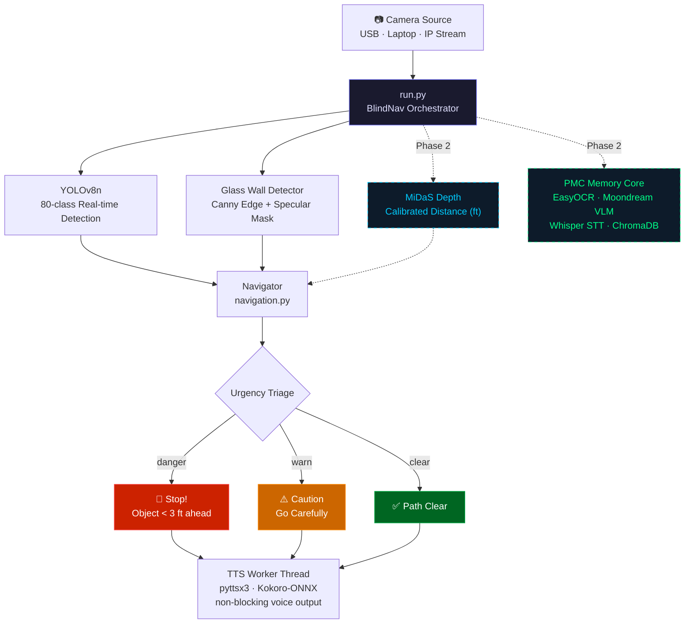

# blind-nav

> **Spectra** — A multimodal AI accessibility assistant that reads documents, interprets visual surroundings, and delivers contextual information through speech.

**Domain:** Assistive Technology & Accessibility  
**Track:** Open Innovation

---

## What It Does

Spectra gives visually impaired users a real-time spoken understanding of their environment. Point a camera at anything — a room, a document, a sign — and the system tells you what is there, what is nearby, and what to watch out for.

Built on the Personal Memory Core (PMC) platform, Spectra combines:

- **Object detection** (YOLOv8) — identifies people, furniture, doors, obstacles
- **Spatial awareness** — classifies objects as left / center / right and estimates distance
- **Glass wall detection** — Canny edge + specular heuristic finds transparent barriers YOLO cannot see
- **Monocular depth** (optional, Phase 2) — MiDaS estimates real distance per object
- **OCR** (EasyOCR) — reads text from signs, labels, documents
- **Scene description** (Moondream VLM) — natural-language caption of any visual scene
- **Voice output** (Kokoro TTS / pyttsx3) — all information delivered as speech, no screen required

---

## Quick Demo

```
Navigation system ready.
→ "Chair directly ahead, very close. Stop!"
→ "Glass wall to your left, about 4 feet. Go carefully."
→ "Path clear. Person far right."
[D key] → "To your left: 2 chairs. Centre: 1 person, 1 laptop. To your right: 1 door."
```

---

## Architecture



---

## Key Features

| Feature | Status |
|---------|--------|
| Real-time YOLOv8 detection | ✅ Phase 1 |
| Left / centre / right spatial mapping | ✅ Phase 1 |
| Bbox-based distance estimation | ✅ Phase 1 |
| Danger / warn / clear urgency levels | ✅ Phase 1 |
| Priority object list (person, door, chair first) | ✅ Phase 1 |
| Threaded TTS (non-blocking) | ✅ Phase 1 |
| Runtime confidence adjustment (+/−) | ✅ Phase 1 |
| Scene description on demand (D key) | ✅ Phase 1 |
| Heuristic glass wall detection | ✅ Phase 1 |
| MiDaS monocular depth | 🔲 Phase 2 |
| Floor / navigable path segmentation | 🔲 Phase 2 |
| OCR document reading (EasyOCR) | 🔲 Phase 2 (PMC integration) |
| Moondream scene captioning | 🔲 Phase 2 (PMC integration) |
| PMC long-term scene memory | 🔲 Phase 2 |

---

## Setup

### Windows (one-click)
```bat
run.bat
```

### Linux / macOS
```bash
chmod +x run.sh && ./run.sh
```

### Manual
```bash
# 1. Install PyTorch (choose your CUDA version at pytorch.org)
pip install torch torchvision torchaudio --index-url https://download.pytorch.org/whl/cu128

# 2. Install dependencies
pip install -r requirements.txt

# 3. Download YOLO weights
python download_models.py

# 4. Run
python run.py
```

---

## Runtime Controls

| Key | Action |
|-----|--------|
| `D` | Describe full surroundings (left / centre / right summary) |
| `+` | Increase detection confidence (fewer, more certain detections) |
| `−` | Decrease detection confidence (more detections, some noise) |
| `Q` | Quit |

---

## Configuration

Edit [`config.py`](config.py) — all settings in one place:

```python
CAM_INDEX      = 0                  # 0 = laptop cam | 1 = USB cam | "http://IP/stream"
YOLO_MODEL     = "models/yolov8n.pt" # nano (fast) or yolov8s.pt (accurate)
CONFIDENCE     = 0.50               # detection threshold
USE_DEPTH      = False              # True = enable Phase 2 MiDaS depth
TTS_RATE       = 170                # speech rate (words per minute)
DANGER_DISTANCE_FT = 3              # distance threshold for "Stop!" alerts
```

---

## Hardware Tested

- **Windows 11** — Intel Core i7 + NVIDIA RTX 5050 Laptop GPU (CUDA 12.8, sm_120)
- **Laptop webcam** (index 0, DirectShow)
- **USB Logitech C920**
- **ESP32-CAM** HTTP stream

---

## Requirements

- Python 3.10+
- PyTorch 2.2+ (GPU strongly recommended for Phase 2)
- CUDA 12.x (for RTX 40/50 series GPUs)
- USB or IP camera

See [`requirements.txt`](requirements.txt) for full list.

---

## Roadmap

### Phase 1 (Current)
Real-time object detection + voice navigation. Works on CPU, runs fast on GPU.

### Phase 2 (In Development)
- MiDaS monocular depth for calibrated distance
- Floor segmentation (navigable path awareness)
- EasyOCR document and sign reading
- Moondream VLM full scene captioning
- Long-term environmental memory via PMC ChromaDB

---

## Built On

| Component | Purpose |
|-----------|---------|
| [Ultralytics YOLOv8](https://github.com/ultralytics/ultralytics) | Real-time object detection |
| [MiDaS](https://github.com/isl-org/MiDaS) | Monocular depth estimation (Phase 2) |
| [OpenCV](https://opencv.org) | Camera capture, glass wall detection, overlay rendering |
| [pyttsx3](https://github.com/nateshmbhat/pyttsx3) | Cross-platform offline TTS |
| [EasyOCR](https://github.com/JaidedAI/EasyOCR) | Document and sign text recognition (Phase 2) |
| [Kokoro-ONNX](https://github.com/hexgrad/kokoro) | Neural TTS for natural speech (Phase 2) |
| [PMC / ContextAI](https://github.com/CyberShadowSensei/contextAI) | Memory, RAG, Moondream integration |

---

## License

MIT
